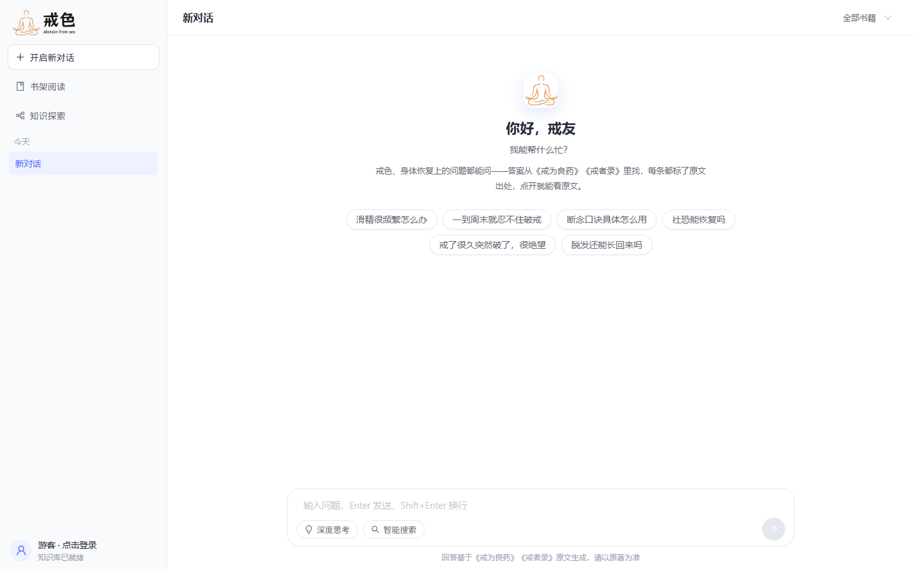
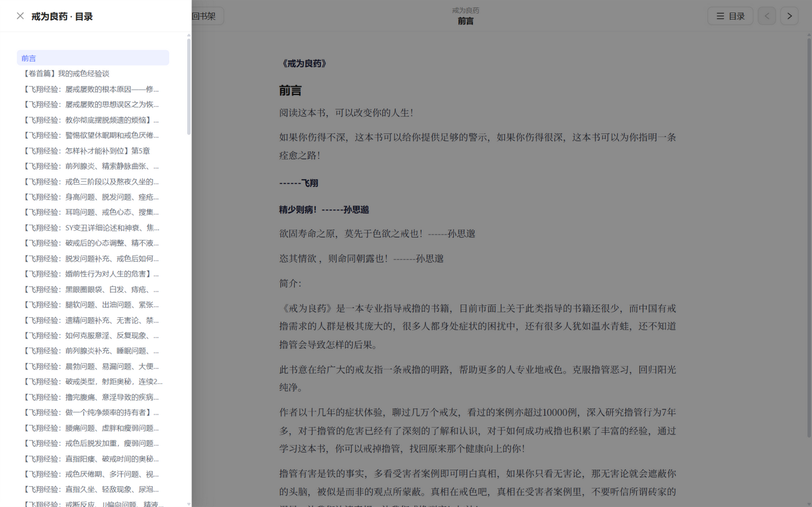
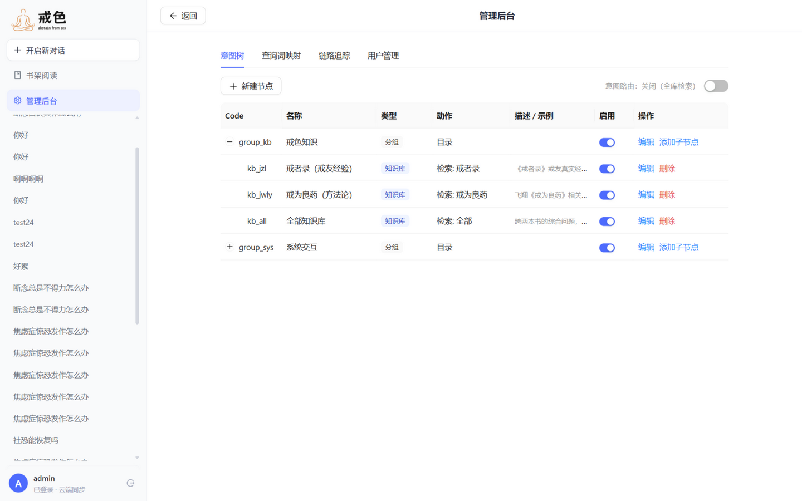

# 戒色知识库 · RAG 问答与在线阅读

基于《戒为良药》（飞翔）与《戒者录》（前辈 编）两本书构建的 RAG 知识库问答系统：

- **对话式问答**：左侧会话栏（历史持久化）+ 右侧对话主区，支持「深度思考」「智能搜索」模式
- **在线阅读**：两本书完整预览，目录导航、章节翻页
- **引用跳转**：引用卡片展示所用原文，点击"查看原文"跳转到阅读器对应段落并高亮

技术栈：**FastAPI + React 18 (Vite + Ant Design 5 + Framer Motion) + PostgreSQL (Docker) + jieba**

详细设计见 [docs/实现文档.md](docs/实现文档.md)。

## 页面预览

| 对话问答（RAG 答案 + 引用来源） | 在线阅读（目录导航 + 翻页） |
|:---:|:---:|
|  |  |
| **书架** | **管理后台（意图树路由）** |
|  |  |

## 快速开始

```bash
# 0. 准备 PostgreSQL（本地 Docker，pgvector 镜像亦可）
docker run -d --name postgres -p 5432:5432 -e POSTGRES_PASSWORD=postgres pgvector/pgvector:pg16
psql -h 127.0.0.1 -U postgres -c "CREATE DATABASE jiese"   # 或 docker exec 进入容器创建

# 1. 构建知识库（解析两本 EPUB → 去重 → 分块 → 分词 → PostgreSQL，约 40 秒）
cd backend
pip install -r requirements.txt
python scripts/build_kb.py

# 2. 构建前端（产物输出到 backend/static/，由 FastAPI 直接托管）
cd ../frontend
npm install
npm run build

# 3. 启动服务（API + 前端一体）
cd ../backend
python -m uvicorn app.main:app --port 8000
# 打开 http://127.0.0.1:8000
```

数据库连接通过 `backend/.env` 覆盖（默认 `postgres/postgres@127.0.0.1:5432/jiese`）。

## 增强层构建（可选：共识层 / 实体关系）

三项增强功能开箱即用为降级模式（无数据不生效），按需构建：

```bash
cd backend
python scripts/seed_terms.py --auto data/terms.csv   # 术语表种子（实体加成 + 关系挖掘的基础）
python scripts/backfill_entities.py                  # 全量 chunk 实体打标（检索加权）
python scripts/mine_edges.py                         # 挖掘受限关系（对治/导致，运行时用证据≥2的边）
python scripts/build_claims.py --concurrency 8       # Claim 共识层（LLM 抽取约 40 分钟，断点续跑）
```

## 启用大模型生成与向量检索（可选）

不配置任何 Key 时系统开箱即用（BM25 检索 + 原文摘录模式）。复制 `backend/.env.example` 为 `backend/.env` 并填写：

```ini
OPENAI_BASE_URL=https://open.bigmodel.cn/api/paas/v4   # 任意 OpenAI 兼容端点
OPENAI_API_KEY=你的Key
LLM_MODEL=glm-4-flash          # 启用答案生成 + 多轮查询改写
EMBEDDING_MODEL=embedding-3    # 启用向量混合检索（需重新运行 build_kb.py）
```

## 戒色吧 AI 自动回复机器人（可选）

基于 [aiotieba](https://github.com/lumina37/aiotieba/) 拉取戒色吧新帖 → 调用本机 `/api/chat` 完整问答链路（术语归一化 / 意图识别 / 检索 / LLM 生成）→ 自动回帖。意图为闲聊、检索无命中的帖子自动跳过；LLM 生成失败（摘录回退）的帖子记为 failed 下轮重试。所有处理留痕于 `backend/data/tieba_bot.db`。

**个性化回复**：回帖前会拉取楼主近期主题帖与公开回复（**读帖与拉历史都不需要登录**；对方隐藏动态时自动降级为通用回复），用 LLM 提炼一段背景画像（戒色天数 / 主要症状 / 破戒诱因 / 已试方法，缓存 7 天），通过 `/api/chat` 的 `user_context` 字段只注入生成侧——检索查询仍是原帖问题，不被背景污染。

```bash
cd backend
pip install -r requirements.txt        # aiotieba 固定 4.7.1（v4.8 起官方移除了回帖接口）
python scripts/tieba_bot.py --scan     # 只看会选哪些帖子（不调问答、不发帖、不写状态）
python scripts/tieba_bot.py --whoami   # 校验 BDUSS 是否有效（打印账号名，不发帖）
python scripts/tieba_bot.py --once     # 单轮 dry-run：生成回复仅打印，不实际回帖
python scripts/tieba_bot.py --once --post  # 单轮真实回帖（需 .env 配 TIEBA_BDUSS）
python scripts/tieba_bot.py --once --post --tid 1234567890  # 只回复指定帖子（可控测试）
python scripts/tieba_bot.py            # 常驻轮询（默认 dry-run；加 --post 才真实回帖）
python scripts/tieba_bot.py --list     # 查看处理记录    --reset 清空记录
```

`TIEBA_BDUSS` 获取方式：浏览器登录贴吧 → F12 → Application → Cookies → 复制 `BDUSS`，写入 `backend/.env`（未配置时强制 dry-run）。频率与过滤均可通过 `.env` 调整（`TIEBA_*` 前缀，默认：单轮最多 2 帖、间隔 120 秒、每日上限 20 帖、只处理 24h 内新帖、跳过热帖/短帖/广告词命中）。完整参数见 `backend/scripts/tieba_bot.py` 文件头。

> ⚠️ 注意：百度对自动化发帖风控较严（aiotieba 官方正是因此移除了发布接口），账号存在被删帖/封禁的风险。请保持默认低频参数，先用 `--scan` 与 dry-run 观察回复质量，确认无误后再 `--post`。

> 登录要求：拉帖、读楼、拉楼主历史都是公开接口，**无需登录**；只有真实回帖需要 `TIEBA_BDUSS`（未配置时强制 dry-run）。作者背景可用 `TIEBA_AUTHOR_CONTEXT=0` 关闭、`TIEBA_AUTHOR_PROFILE_TTL_DAYS=7` 调整画像缓存天数（0=每次重新生成）。

## 部署（GitHub Actions CI/CD → 阿里云 ECS）

推送 `master` 自动执行：**构建前端 → 构建 Docker 镜像 → 推送阿里云 ACR → SSH 到 ECS 拉取镜像并重启**（ECS 与 ACR 同地域时走 VPC 内网拉取，秒级免流量）。Secrets 未配置时 workflow 自动跳过部署步骤（保持绿色），配置完成后每次 push 即自动上线，也可在 Actions 页手动触发。

### 当前配置（已完成，换仓库/换服务器时参考）

1. **阿里云 ACR**：命名空间 `resumable-upload`；镜像仓库 `jiese` 无需手动创建——crpi 个人版实例在首次推送时自动建仓；
2. **部署密钥**：`~/.ssh/jiese-deploy`（专用密钥，公钥已装入服务器 `/root/.ssh/authorized_keys`）；
3. **GitHub Secrets**（仓库 Settings → Secrets and variables → Actions）：

| Secret | 必填 | 说明 |
|---|:---:|---|
| `SSH_HOST` | ✅ | 服务器公网 IP |
| `SSH_PRIVATE_KEY` | ✅ | `jiese-deploy` **私钥整文件内容** |
| `ACR_REGISTRY` | ✅ | 访问域名，如 `crpi-xxx.cn-beijing.personal.cr.aliyuncs.com` |
| `ACR_NAMESPACE` | ✅ | ACR 命名空间 |
| `ACR_DOCKER_USERNAME` / `ACR_DOCKER_PASSWORD` | ✅ | ACR「访问凭证」页的固定密码 |
| `SSH_USER` / `SSH_PORT` | | 默认 `root` / `22` |
| `APP_PORT` | | 对外端口（默认 `8080`）。端口唯一来源，部署时自动写入服务器 `.env` |

### 服务器布局（`/opt/jiese`）

```
.env                      # 环境变量（compose 自动读取）：EPUB 路径、APP_PORT、LLM Key
books/                    # EPUB 语料：jwly.epub / jzl.epub
docker-compose.prod.yml   # CI 每次部署自动同步
init-db.sql               # db 容器首次初始化时创建 pgvector 扩展
```

知识库数据存放在 PostgreSQL 数据卷 `pgdata` 中，**代码部署不会重建知识库**。

### 首次初始化（已完成；换新服务器时照做）

```bash
cd /opt/jiese
# 1. 上传两本 EPUB 到 books/（文件名 jwly.epub / jzl.epub，或改 .env 里的 EPUB_JWLY/EPUB_JZL）
# 2. 启动数据库（pgvector 镜像，需服务器能拉取 Docker Hub；失败则配置加速器）
docker compose -f docker-compose.prod.yml up -d db
# 3. 构建知识库（约 50 秒，写入 PostgreSQL）
docker compose -f docker-compose.prod.yml run --rm app python scripts/build_kb.py
```

> 增强层（实体/共识）与本地一致，需另把 `backend/data/terms.csv` 上传到服务器后再跑对应脚本。

### 启用大模型（可选）

编辑服务器 `/opt/jiese/.env` 填入 `OPENAI_*` / `LLM_MODEL` 后重建应用容器：

```bash
cd /opt/jiese && docker compose -f docker-compose.prod.yml up -d app
```

留空即 BM25 检索 + 原文摘录降级模式（无需任何 Key）。

### 回滚

历史镜像保留在 ACR（tag `app-<commit 前 8 位>`）：

```bash
docker pull <ACR_REGISTRY>/<ACR_NAMESPACE>/jiese:app-<sha8>
docker tag  <ACR_REGISTRY>/<ACR_NAMESPACE>/jiese:app-<sha8> jiese:latest
cd /opt/jiese && docker compose -f docker-compose.prod.yml up -d app
```

## 知识库规模（当前构建）

| 指标 | 数值 |
|---|---|
| 书籍 | 2 本，325 个阅读页，342 万字 |
| 知识块 | 6591 个（均值 571 字），去重后入索引 6434 |
| 段落 | 25239 个（引用跳转锚点） |
| 目录节点 | 455 个（含《戒者录》文件内锚点小节） |

## 目录结构

```
backend/
  app/            # FastAPI 应用（解析/分块/去重/词表/BM25/检索/生成）
  scripts/build_kb.py   # 构建管线
  data/           # 生成物（embeddings.npy 等，不入库）
  static/         # 前端构建产物（npm run build 生成，不入库）
frontend/         # React 源码（antd + framer-motion）
docs/实现文档.md  # 架构与设计文档
```

## 主要 API

| 方法 | 路径 | 说明 |
|---|---|---|
| GET | `/api/books` | 书列表 |
| GET | `/api/books/{id}/toc` | 目录树 |
| GET | `/api/docs/{id}` | 阅读页（含段落锚点 ID） |
| POST | `/api/search` | 纯检索 |
| POST | `/api/chat` | 问答（返回答案 + 引用） |
| GET | `/api/health` | 服务状态 |

交互式文档：http://127.0.0.1:8000/docs
